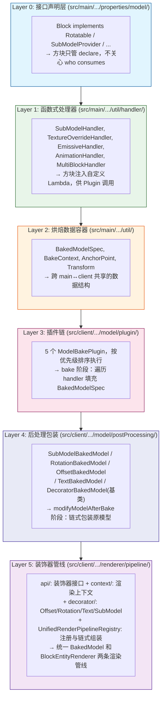
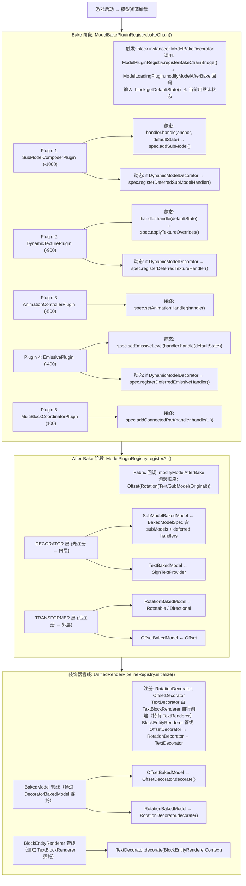
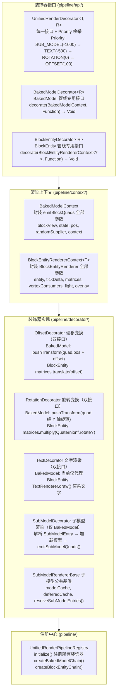
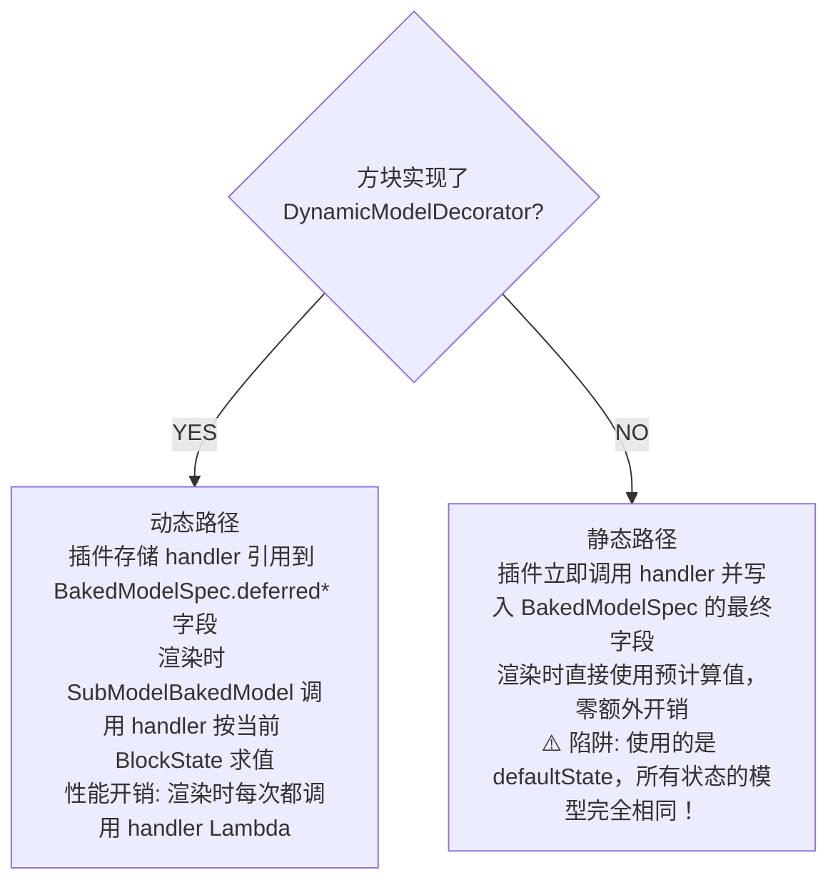
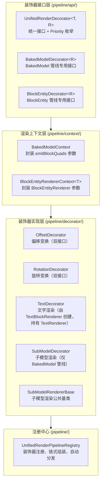
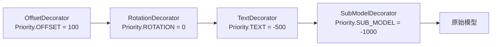
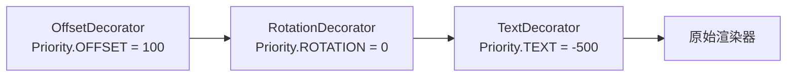

# 渲染管线技术方案与实施报告

> 版本：2026-10-29 · 状态：反映当前代码实际实现

---

## 1. 技术方案概述

### 1.1 目标

构建一套**声明式方块渲染管线**：方块通过实现接口声明能力，客户端在模型加载和渲染两个阶段自动识别并应用对应的渲染变换，实现"新增方块 → 零客户端代码改动"。

### 1.2 架构分层



---

## 2. 渲染管线流程（当前实际实现）

### 2.1 两阶段时序



### 2.2 装饰器管线架构



### 2.3 静态 vs 动态分流



---

## 3. 当前实现状态 vs 技术方案差异

### 3.1 已完成项 ✅

| 组件 | 文件 | 状态 |
|------|------|:----:|
| 6 个函数式处理器 | `util/handler/*.java` | ✅ |
| 6 个能力接口 | `properties/model/*.java` | ✅ |
| AnchorPoint + Transform | `util/AnchorPoint.java`, `util/Transform.java` | ✅ |
| BakeContext + BakedModelSpec | `util/BakeContext.java`, `util/BakedModelSpec.java` | ✅ |
| ModelBakePlugin 接口 | `client/model/ModelBakePlugin.java` | ✅ |
| ModelBakePluginRegistry（5 插件链） | `client/model/ModelBakePluginRegistry.java` | ✅ |
| 5 个 Plugin 实现 | `client/model/plugin/*.java` | ✅ |
| SubModelBakedModel | `client/model/postProcessing/SubModelBakedModel.java` | ✅ |
| RotationBakedModel | `client/model/postProcessing/RotationBakedModel.java` | ✅ |
| OffsetBakedModel | `client/model/postProcessing/OffsetBakedModel.java` | ✅ |
| TextBakedModel | `client/model/postProcessing/TextBakedModel.java` | ✅ |
| DecoratorBakedModel 基类 | `client/model/postProcessing/DecoratorBakedModel.java` | ✅ |
| ModelPluginRegistry 分流 | `client/model/ModelPluginRegistry.java` | ✅ |
| DynamicModelDecorator 标记 | `properties/model/DynamicModelDecorator.java` | ✅ |
| BakedModelSpec 延迟字段 | `deferredSubModelHandler/TextureOverride/Emissive` 字段 | ✅ |
| SubModelComposerPlugin 延迟注册 | `registerDeferredSubModelHandler()` | ✅ |
| DynamicTexturePlugin 延迟注册 | `registerDeferredTextureHandler()` | ✅ |
| EmissivePlugin 延迟注册 | `registerDeferredEmissiveHandler()` | ✅ |
| **装饰器管线** | `client/renderer/pipeline/` | ✅ |
| UnifiedRenderDecorator 接口 | `pipeline/api/UnifiedRenderDecorator.java` | ✅ |
| BakedModelDecorator 接口 | `pipeline/api/BakedModelDecorator.java` | ✅ |
| BlockEntityDecorator 接口 | `pipeline/api/BlockEntityDecorator.java` | ✅ |
| BakedModelContext | `pipeline/context/BakedModelContext.java` | ✅ |
| BlockEntityRendererContext | `pipeline/context/BlockEntityRendererContext.java` | ✅ |
| OffsetDecorator | `pipeline/decorator/OffsetDecorator.java` | ✅ |
| RotationDecorator | `pipeline/decorator/RotationDecorator.java` | ✅ |
| TextDecorator | `pipeline/decorator/TextDecorator.java` | ✅ |
| TextBlockRenderer 装饰器链 | `client/renderer/TextBlockRenderer.java` | ✅ |
| SubModelDecorator | `pipeline/decorator/SubModelDecorator.java` | ✅ |
| SubModelRendererBase 基类 | `pipeline/decorator/SubModelRendererBase.java` | ✅ |
| UnifiedRenderPipelineRegistry | `pipeline/UnifiedRenderPipelineRegistry.java` | ✅ |

### 3.2 待完成项 🚧

| 组件 | 缺失部分 | 影响 |
|------|----------|------|
| **DynamicTextureBakedModel** | 尚无 BakedModel 消费 `deferredTextureOverrideHandler` | 动态贴图无法按 BlockState 切换 |
| **EmissiveBakedModel** | 尚无 BakedModel 消费 `deferredEmissiveHandler` | 动态发光无法按 BlockState 计算 |
| **MultiBlock BakedModel** | 接口+Plugin 已有，缺渲染时合并模型的 BakedModel | 多方块组合不可见 |

**三个缺失项的共性问题**：handler 已存入 BakedModelSpec，但 `SubModelBakedModel.getQuads()` 只消费了 `deferredSubModelHandler`，Texture/Emissive handler 暂存但未被读取。

### 3.3 技术方案与实现的关键差异

| 差异点 | 方案文档描述 | 实际代码实现 | 影响评估 |
|--------|-------------|-------------|---------|
| AnchorPoint 预定义常量 | `AnchorPoint.BOTTLE_SLOT_1/2/3` 作为预定义静态常量 | `AnchorPoint` 无任何预定义常量，方块自行 `new AnchorPoint(...)` | 用户代码中需自行创建，缺少开箱即用的锚点库 |
| SubModelHandler 签名 | `(anchor, state) -> modelPath` | 完全一致 ✅ | — |
| bake 阶段使用 defaultState | 文档未明确说明 | `ModelBakePluginRegistry.bakeChain(block, block.getDefaultState(), ...)` | 静态路径正确；动态路径 handler 需在渲染时用实际 state 重新求值 |
| DynamicModelDecorator | 文档提及但未强调必要性 | 分流关键：不实现此接口 = 静态路径 = 所有状态同一模型 | 若测试方块不实现此接口，LIT 切换不会改变贴图 |
| EmissivePlugin 延迟注册 | 预期所有动态方块均可延迟 | 当前仅检查 `DynamicModelDecorator`，与 DynamicTexturePlugin 一致 | 逻辑一致，无问题 |

---

## 4. 测试方块配置（与当前架构对齐版）

### 4.1 对比：原始方案 vs 当前架构对齐版

原始测试方案中的 `AnchorPoint.BOTTLE_SLOT_1` 等预定义常量**当前不存在**，需改为：
- 方案 A：在 `AnchorPoint` 中添加预定义常量
- 方案 B：测试方块内联创建（当前 WineCabinetBlock 的做法）

推荐方案 A——一步到位，便于后续复用。但需确认不破坏现有 `WineCabinetBlock` 的独立锚点布局（6 个槽位 vs 3 个槽位）。

### 4.2 测试方块 1：TestWineCabinetBlock（子模型测试）

```java
/**
 * 测试酒柜方块——验证 SubModelComposerPlugin。
 * <p>
 * 基础模型：glass（透明玻璃外壳）
 * 子模型：3 个 oak_planks（模拟酒瓶，缩小至 30%）
 * 实现 DynamicModelDecorator：渲染时按 BlockState 动态求值子模型
 * </p>
 */
public class TestWineCabinetBlock extends CustomBlock
        implements Directional, SubModelProvider, DynamicModelDecorator, Layered {

    private static final List<AnchorPoint> ANCHORS = List.of(
        new AnchorPoint("bottle_slot_1", new Vec3d(0.25, 0.35, 0.5), Vec3d.ZERO, 0.3f),
        new AnchorPoint("bottle_slot_2", new Vec3d(0.50, 0.35, 0.5), Vec3d.ZERO, 0.3f),
        new AnchorPoint("bottle_slot_3", new Vec3d(0.75, 0.35, 0.5), Vec3d.ZERO, 0.3f)
    );

    public TestWineCabinetBlock(Settings settings) {
        super(settings);
        setDefaultState(initDirection(getDefaultState()));
    }

    @Override public List<AnchorPoint> getAnchors() { return ANCHORS; }

    @Override
    public SubModelHandler getSubModelHandler() {
        return (anchor, state) -> switch (anchor.name()) {
            case "bottle_slot_1" -> "minecraft:oak_planks";
            case "bottle_slot_2" -> "minecraft:spruce_planks";
            case "bottle_slot_3" -> "minecraft:birch_planks";
            default -> null;
        };
    }

    @Override public RenderLayerType getRenderLayerType() { return RenderLayerType.CUTOUT; }
    @Override public void appendProperties(...) { super.appendProperties(builder); Directional.super.appendProperties(builder); }
}
```

**blockstate JSON 要点**：
```json
{ "variants": { "facing=north": { "model": "chinese-core-building:block/glass" }, ... } }
```

### 4.3 测试方块 2：TestLightBulbBlock（贴图 + 发光测试）

```java
/**
 * 测试灯泡方块——验证 DynamicTexturePlugin + EmissivePlugin。
 * <p>
 * LIT=false: stone 贴图, 发光 0
 * LIT=true:  stone_bricks 贴图, 发光 15
 * 实现 DynamicModelDecorator：渲染时按实际 LIT 状态动态切换贴图和发光等级
 * </p>
 */
public class TestLightBulbBlock extends CustomBlock
        implements StatefulTextureProvider, LightEmissive, DynamicModelDecorator, Layered {

    public static final BooleanProperty LIT = Properties.LIT;

    public TestLightBulbBlock(Settings settings) {
        super(settings);
        setDefaultState(getDefaultState().with(LIT, false));
    }

    @Override public TextureOverrideHandler getTextureOverrideHandler() {
        return (state) -> state.get(LIT)
            ? Map.of("#all", "minecraft:block/stone_bricks")
            : Map.of("#all", "minecraft:block/stone");
    }

    @Override public EmissiveHandler getEmissiveHandler() {
        return (state) -> state.get(LIT) ? 15 : 0;
    }

    @Override public RenderLayerType getRenderLayerType() { return RenderLayerType.CUTOUT; }
    @Override public void appendProperties(...) { super.appendProperties(builder); builder.add(LIT); }
}
```

**⚠️ 架构阻塞点**：此方块正确运行需要 `DynamicTextureBakedModel` 和 `EmissiveBakedModel` 两个组件完成（当前 🚧）。

---

## 5. 实施路线图

### 阶段一：补齐渲染层消费方（阻塞项，优先）

| 步骤 | 任务 | 说明 |
|:----:|------|------|
| 5.1 | 实现 `DynamicTextureBakedModel` | 渲染时从 `deferredTextureOverrideHandler` 获取贴图覆盖，替换 Quad 材质 |
| 5.2 | 实现 `EmissiveBakedModel` | 渲染时从 `deferredEmissiveHandler` 获取发光等级，设置 Quad 自发光标志 |
| 5.3 | 集成到 `ModelPluginRegistry` | 在 DECORATOR 阶段注册两个新 BakedModel 包装器 |

### 阶段二：测试方块实现

| 步骤 | 任务 | 依赖 |
|:----:|------|------|
| 5.4 | 创建 `TestWineCabinetBlock` | 阶段一完成 |
| 5.5 | 创建 `TestLightBulbBlock` | 5.1 + 5.2 完成 |
| 5.6 | 创建 `TestGearBlock`（动画测试）| 验证 AnimationHandler 的 `List<Transform>` 逐帧更新 |

### 阶段三：缓存与优化

| 步骤 | 任务 |
|:----:|------|
| 5.7 | 模型实例缓存（Caffeine 或 HashBiMap）→ 避免重复加载同一 Identifier 的 UnbakedModel |
| 5.8 | Quad 缓存 → 静态路径方块缓存 `List<BakedQuad>`，跳过重复 bake 调用 |

### 阶段四：MultiBlock

| 步骤 | 任务 |
|:----:|------|
| 5.9 | 实现 MultiBlock BakedModel → 渲染时扫描相邻方块，合并顶点到当前模型 |

---

## 6. 架构风险与技术债务

### 6.1 已知风险

| 风险 | 严重度 | 说明 |
|------|:------:|------|
| bake 阶段只用 defaultState | ⚠️ 中 | 静态路径方块的所有 BlockState 实例共享同一个 BakedModelSpec（贴图/子模型完全一致）。若某方块需要按状态切换贴图，必须实现 `DynamicModelDecorator` |
| SubModelBakedModel 未消费 Texture/Emissive handler | 🔴 高 | handler 已正确存入 spec，但渲染时未读取——动态贴图和发光功能实际上不可用 |
| AnchorPoint 缺少预定义常量 | 🟡 低 | 每个测试方块手动 new 锚点，不符合"开箱即用"目标 |

### 6.2 技术债务

1. **subModelProvider → SubModelComposerPlugin 中的两重路径混合**：静态立即求值 + 延迟 handler 注册在同一个 plugin 中耦合，后续可拆分为 `StaticSubModelComposerPlugin` + `DeferredSubModelComposerPlugin`
2. **MultiBlockHandler 需要 World 参数**：`handle(BlockState, World, BlockPos)` 中的 World 在 bake 阶段为 null——MultiBlock 只能在渲染时按实际 World 求值，与当前架构的 bake 阶段语义冲突

---

## 7. 装饰器模式重构（2026-10-17，2026-10-18 更新文字渲染）

### 7.1 背景

原有架构中，BakedModel 管线（`postProcessing/*.java`）和 BlockEntityRenderer 管线（`TextBlockRenderer`）的变换逻辑（旋转/偏移）各自独立实现，存在代码重复和变换不一致的风险。

### 7.2 重构方案

采用**装饰器设计模式**，将两条渲染管线统一到同一套装饰器链中：



### 7.3 装饰器链结构

**BakedModel 管线**（模型烘焙后处理）：



**BlockEntityRenderer 管线**（每帧渲染）：



**优先级规则**：数值越小越先执行（越靠近内层）。

**包装方向规则（两条管线相反）**：

| 管线 | 链构建 | 包装方向 | 原因 |
|------|--------|----------|------|
| BakedModel | `BakedModelDecorator.createChain` | 降序（高优先级先包装外层） | `RenderContext.pushTransform` 后进先出 |
| BlockEntityRenderer | `BlockEntityDecorator.createChain` | 升序（低优先级先包装内层） | `MatrixStack` 右乘，执行顺序即变换顺序 |

两条管线排序规则相同（按优先级升序排序），但包装方向相反，最终矩阵统一为 `T(offset) * R(angle)`：先旋转，再沿世界方向平移。
**历史 bug**：BER 管线原用降序包装，导致偏移向量被旋转扭曲（EAST 朝向的 1.5 方块偏移被转到北侧），文字与模型分离；改为升序后修复。

**文字朝向修正**：TextDecorator 内部固定绕 Y 轴旋转 180°，修正 Minecraft 文字默认朝向（-Z 面向方块内部），使文字面向外部玩家（+Z 方向）。

**文字阴影**：`TextRenderer.draw` 的 `shadow` 参数传 `false`，关闭投影。路标文字是贴在板面上的"印刷字"，投影会在浅色板面上形成深色描边，降低可读性且不符合真实路牌观感。发光分支走 `drawWithOutline`，该方法本身无 shadow 参数（绘制描边 + 填充，同时强制满亮度实现自发光）。

### 7.4 后处理包装器重构

`OffsetBakedModel` 和 `RotationBakedModel` 现在继承公共基类 `DecoratorBakedModel<D>`，消除约 60 行重复代码：

```java
// 重构前：每个类独立实现 emitBlockQuads + getQuads
public class OffsetBakedModel extends ForwardingBakedModel {
    private static final OffsetDecorator DECORATOR = new OffsetDecorator();
    @Override
    public void emitBlockQuads(...) { /* 重复逻辑 */ }
    @Override
    public List<BakedQuad> getQuads(...) { return wrapped.getQuads(...); }
}

// 重构后：继承公共基类，仅声明装饰器和条件
public class OffsetBakedModel extends DecoratorBakedModel<OffsetDecorator> {
    private static final OffsetDecorator DECORATOR = new OffsetDecorator();
    public OffsetBakedModel(BakedModel original) {
        super(original, DECORATOR, state -> state.getBlock() instanceof Offset);
    }
}
```

### 7.5 子模型渲染重构

`SubModelDecorator` 和 `SubModelBakedModel` 共享 `SubModelRendererBase` 基类，消除约 150 行重复代码：

| 提取的公共逻辑 | 说明 |
|---------------|------|
| `modelCache` | 线程安全的模型缓存（ConcurrentHashMap） |
| `deferredCache` | 延迟求值缓存（BlockState → SubModelEntry 列表） |
| `resolveSubModelEntries()` | 解析子模型条目（支持立即/延迟两种模式） |
| `initializeSubModels()` | 延迟初始化（线程安全，仅执行一次） |
| `loadModelWithFallback()` | 模型加载与回退策略 |
| `isMissingModel()` | 缺失模型判断 |

### 7.6 关键设计决策

| 决策 | 说明 |
|------|------|
| **分离两个装饰器接口** | Java 泛型限制：一个类不能实现相同接口不同泛型参数，因此创建 `BakedModelDecorator` 和 `BlockEntityDecorator` 两个独立接口 |
| **TextDecorator 独立创建** | TextDecorator 持有 TextRenderer 引用，由 TextBlockRenderer 构造函数创建，避免 MinecraftClient.getInstance().textRenderer 在初始化阶段返回 null |
| **BlockEntityRenderer 完整装饰器链** | TextBlockRenderer 通过 `createBlockEntityChain()` 获取 Offset→Rotation→Text 完整链，保证与 BakedModel 管线变换一致 |
| **两条管线包装方向相反（2026-10 修复）** | BakedModel 侧降序（`pushTransform` 后进先出），BER 侧升序（`MatrixStack` 右乘）。原 BER 侧误用降序导致偏移被旋转扭曲、文字与模型分离 |
| **文字 180° 翻转** | TextDecorator 内部固定绕 Y 轴旋转 180°，修正 Minecraft 文字默认朝向（-Z），使文字面向外部玩家 |
| **文字关闭阴影（2026-10）** | `TextRenderer.draw` 的 `shadow` 传 `false`，避免投影在浅色板面上形成深色描边；发光分支走 `drawWithOutline`（本身无 shadow 参数） |
| **共享装饰器实例** | Offset/Rotation 装饰器在两条管线间共享，保证变换逻辑完全一致 |
| **BlockEntityDecorator.getPriorityValue() 声明为抽象** | 避免与 BakedModelDecorator 的默认方法继承冲突，由实现类显式委托 |
| **DecoratorBakedModel 泛型约束** | `D extends BakedModelDecorator<Void>`，确保类型安全 |
| **渲染器注册机制（2026-10 修复）** | 原 `Renderers.Registry` 枚举 + 类字面量模式因 JLS §12.4.1（类字面量不触发初始化）导致工厂从未注册，已改为 `Renderers.initRenderers()` 直接调用 `BlockEntityRendererRegistry.register()` |

---

## 8. 附录：原版模型纹理变量参考

| 模型 | JSON 路径 | 纹理变量 | 可用贴图 |
|------|----------|----------|----------|
| `cube_all` | `block/cube_all` | `#all` | 任意 16×16 贴图 |
| `cube` | `block/cube` | `#up`, `#down`, `#north`, `#south`, `#east`, `#west` | 各面独立 |
| `cube_column` | `block/cube_column` | `#end`, `#side` | 顶底 + 侧面 |
| `glass` | `block/glass`（继承 `cube_all`） | `#all` | `block/glass` |
| `stone` | `block/stone`（继承 `cube_all`） | `#all` | `block/stone` |
| `stone_bricks` | `block/stone_bricks`（继承 `cube_all`） | `#all` | `block/stone_bricks` |
| `oak_planks` | `block/oak_planks`（继承 `cube_all`） | `#all` | `block/oak_planks` |