# Block Properties API Wiki

> 方块能力接口体系 —— 以接口声明能力，客户端自动消费，遵循开闭原则（OCP）。

---

## 1. 设计理念

传统 Fabric Mod 做法：每种方块在客户端写一堆 `if (block instanceof XxxBlock)` 的硬编码判断。本模块**反其道而行之**：

- **方块只声明能力**（通过接口），不关心"谁来消费"
- **客户端统一扫描接口**，自动注册渲染器 / 模型后处理 / 渲染层
- **新增能力 = 新增接口 + 新增消费方**，不改既有代码
- **非渲染能力接口**（如 `PlacementBehavior`）归于 `util` 包，确保 `model` 包职责内聚

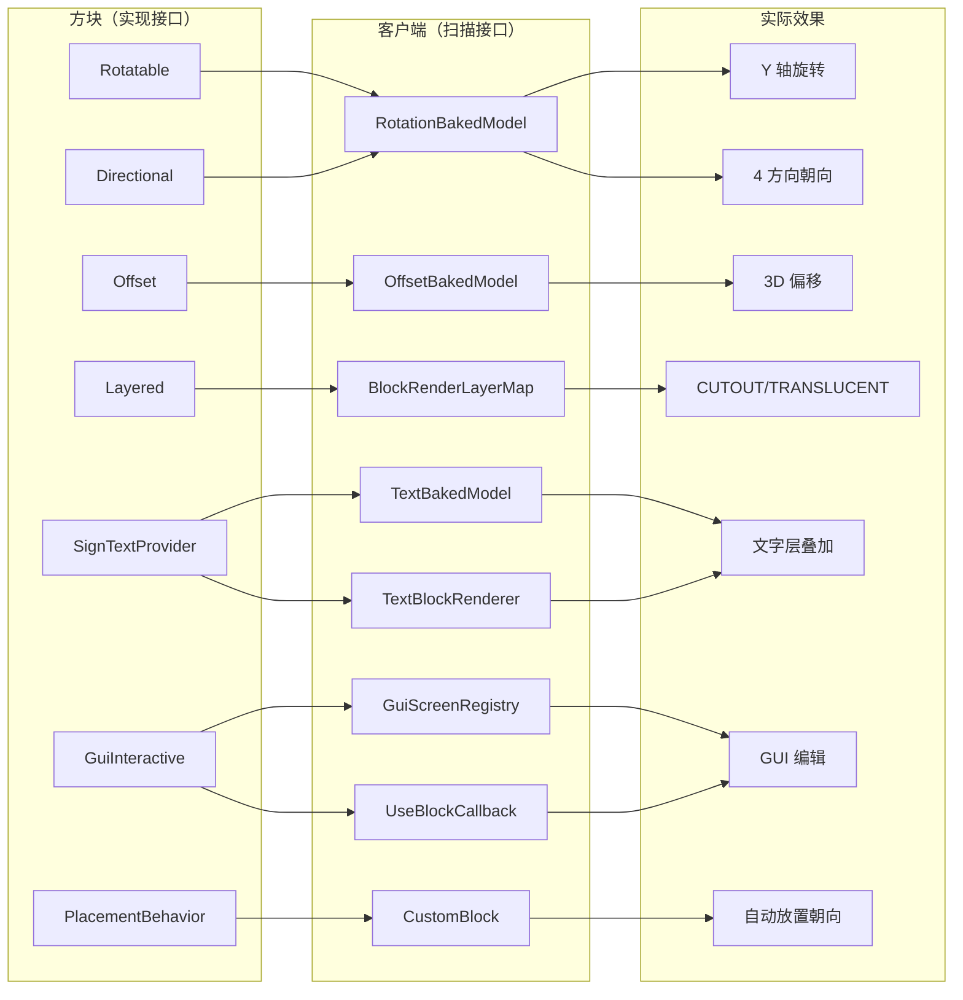

> **说明**：文字功能模块是公共基础设施，任何实现 `SignTextProvider` 的方块都可以复用
> 文字渲染、GUI 编辑、网络同步等完整能力，不限于特定方块类型。

---

## 2. 接口层次图

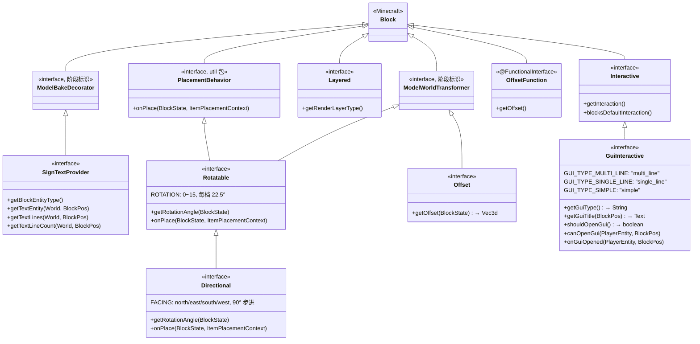

### 典型组合

| 方块类型 | 应实现的接口 |
|----------|-------------|
| 需要旋转 + 偏移的路标 | `Directional` + `Offset` + `Layered` |
| 只需旋转的装饰方块 | `Directional` + `Layered` |
| 可自由角度旋转的方块 | `Rotatable` + `Layered` |
| 半透明方块 | `Layered`（TRANSLUCENT） |
| 纯文字显示方块 | `Directional` + `Offset` + `Layered` + `BlockEntityProvider` + `SignTextProvider` + `GuiInteractive` |
| 可交互编辑的文字方块 | `GuiInteractive` + `SignTextProvider` + `BlockEntityProvider` |
| 需要权限控制的编辑方块 | `GuiInteractive`（覆盖 `canOpenGui` 添加权限检查） |

---

## 3. 各接口详细说明

### 3.1 Rotatable（可旋转）

| 项目 | 说明 |
|------|------|
| **用途** | 声明方块支持任意角度旋转（0~15 档，每档 22.5°） |
| **继承** | `extends ModelWorldTransformer, PlacementBehavior` |
| **依赖** | 无（可独立使用） |
| **BlockState 属性** | `ROTATION: IntProperty`（Minecraft 内置 `Properties.ROTATION`） |
| **客户端消费方** | `RotationBakedModel` |
| **服务端消费方** | `CustomBlock.getPlacementState()` 通过 `PlacementBehavior.onPlace()` 自动设置旋转 |
| **构造要求** | `setDefaultState(initRotation(getDefaultState()))` |
| **appendProperties** | 必须显式调用 `Rotatable.super.appendProperties(builder)` |

**核心方法**：

| 方法 | 说明 |
|------|------|
| `initRotation(BlockState)` | 默认 ROTATION=0 |
| `calculateRotation(int)` | 默认原值返回，可自定义旋转值映射 |
| `getRotationAngle(BlockState)` | 从 ROTATION 属性计算弧度角（每档 22.5°） |
| `onPlace(BlockState, ItemPlacementContext)` | 实现 PlacementBehavior，放置时自动设置 ROTATION |
| `getOutlineShape(...)` / `getCollisionShape(...)` | 默认 fullCube，可自定义 |

---

### 3.2 Directional（可朝向）

| 项目 | 说明 |
|------|------|
| **用途** | 声明方块支持 4 方向水平朝向（north/east/south/west） |
| **继承** | `extends Rotatable`（间接继承 `PlacementBehavior`） |
| **依赖** | 无（可独立使用） |
| **BlockState 属性** | `FACING: DirectionProperty`（Minecraft 内置 `Properties.HORIZONTAL_FACING`） |
| **覆盖** | 用 FACING 替代 ROTATION；重写 `onPlace()` 使用 FACING；每方向 90° 增量 |
| **客户端消费方** | `RotationBakedModel`（通过父接口的 `getRotationAngle`） |
| **服务端消费方** | `CustomBlock.getPlacementState()` 通过 `PlacementBehavior.onPlace()` 自动设置朝向 |
| **构造要求** | `setDefaultState(initDirection(getDefaultState()))` |
| **appendProperties** | 必须显式调用 `Directional.super.appendProperties(builder)` |

**核心方法**：

| 方法 | 说明 |
|------|------|
| `initDirection(BlockState)` | 默认 FACING=NORTH |
| `directionToRotation(Direction)` | SOUTH→0, EAST→1, NORTH→2, WEST→3 |
| `getRotationAngle(BlockState)` | 重写 Rotatable：从 FACING 算弧度（每方向 90°） |
| `calculateDirection(ItemPlacementContext)` | 默认取玩家水平朝向 |
| `onPlace(BlockState, ItemPlacementContext)` | 重写 Rotatable：使用 FACING 替代 ROTATION |
| `getOutlineShape(...)` / `getCollisionShape(...)` | 默认 fullCube，可自定义 per-direction |

**getRotationAngle 计算**：

| FACING | rotation | 角度 | 弧度 |
|--------|:--------:|:----:|:----:|
| SOUTH | 0 | 0° | 0 |
| EAST | 1 | 90° | π/2 |
| NORTH | 2 | 180° | π |
| WEST | 3 | 270° | 3π/2 |

---

### 3.3 Offset（可偏移）

| 项目 | 说明 |
|------|------|
| **用途** | 声明方块渲染时需要应用 3D 空间偏移 |
| **依赖** | 无（可与 Rotatable/Directional 任意组合） |
| **BlockState 属性** | 无新增（偏移量由实现类根据已有属性计算） |
| **客户端消费方** | `OffsetBakedModel` + `OffsetDecorator` |

**核心方法**：

| 方法 | 说明 |
|------|------|
| `getOffset(BlockState)` | 返回 `Vec3d`，单位为方块格（1.0 = 1 格） |

**典型实现**（与 Directional 组合）：
```java
public Vec3d getOffset(BlockState state) {
    float ox = BlockUtil.blockConstraint(1.5f); // ≈ 0.09375 格
    return switch (state.get(FACING)) {
        case SOUTH -> new Vec3d(0, 0,  ox);
        case NORTH -> new Vec3d(0, 0, -ox);
        case EAST  -> new Vec3d( ox, 0, 0);
        case WEST  -> new Vec3d(-ox, 0, 0);
        default    -> Vec3d.ZERO;
    };
}
```

---

### 3.4 Layered（可声明渲染层）

| 项目 | 说明 |
|------|------|
| **用途** | 声明方块所需的 Minecraft 渲染层类型 |
| **依赖** | 无 |
| **客户端消费方** | `ChineseCoreBuildingClient.registerRenderLayers()` 自动扫描注册 |

**RenderLayerType 枚举**：

| 枚举值 | 对应 Minecraft RenderLayer | 适用场景 |
|--------|----------------------------|----------|
| `SOLID` | `RenderLayer.getSolid()` | 不透明方块（默认） |
| `CUTOUT` | `RenderLayer.getCutout()` | 带透明贴图的方块（路标、栅栏、树叶） |
| `TRANSLUCENT` | `RenderLayer.getTranslucent()` | 玻璃、冰、粘液块 |

---

### 3.5 SignTextProvider（文字层能力）

| 项目 | 说明 |
|------|------|
| **用途** | 声明方块需要在渲染时叠加可自定义文字层（独立于方块模型） |
| **依赖** | 必须同时实现 `BlockEntityProvider`（因为文字数据存于 BlockEntity） |
| **阶段标识** | 继承 `ModelBakeDecorator`（模型烘焙修饰阶段） |
| **客户端消费方** | `TextBakedModel`（模型烘焙阶段） + `TextBlockRenderer`（BlockEntityRenderer，每帧渲染） |
| **公共性** | 本接口是公共文字功能基础设施的核心，任何需要文字渲染功能的方块都应实现此接口 |

**核心方法**：

| 方法 | 类型 | 说明 |
|------|------|------|
| `getBlockEntityType()` | abstract | 返回此类方块专属的 `BlockEntityType<? extends TextBlockEntity>` |
| `getTextEntity(World, BlockPos)` | default | 类型安全地获取 TextBlockEntity（自动校验类型） |
| `getTextLines(World, BlockPos)` | default | 获取不可变文字行列表；不存在返回 `List.of()` |
| `getTextLineCount(World, BlockPos)` | default | 获取文字行数量；不存在返回 0 |

**与其他接口的关系**：

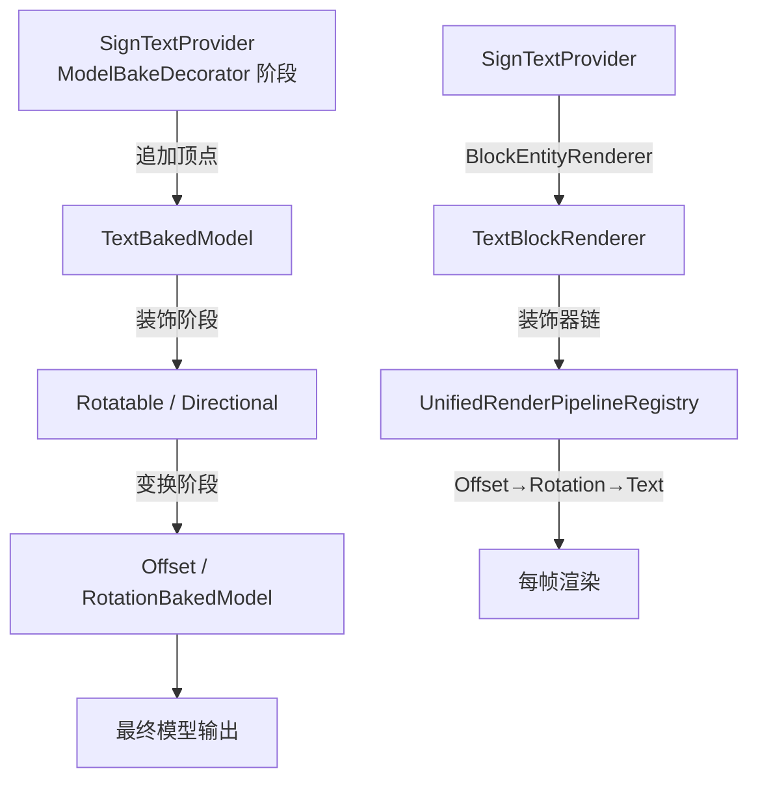

---

### 3.6 Interactive（方块交互能力）

| 项目 | 说明 |
|------|------|
| **用途** | 声明方块拥有右键交互能力，包括服务端处理器和默认行为阻断 |
| **依赖** | 无（可独立使用） |
| **消费方** | `CustomBlock.onUse()`（服务端分发） |

**核心方法**：

| 方法 | 返回值 | 说明 |
|------|--------|------|
| `getInteraction()` | `BlockInteraction` | 服务端交互处理器，默认 null（无服务端逻辑） |
| `blocksDefaultInteraction()` | `boolean` | 是否阻断原版右键默认行为（放置、容器等），默认 true |

**CustomBlock.onUse 两级决策链**：

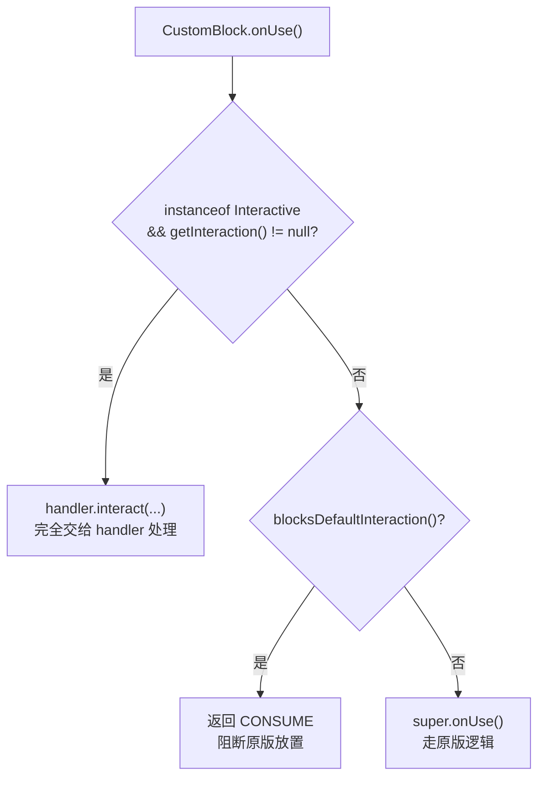

---

### 3.6.1 GuiInteractive（客户端 GUI 交互）

| 项目 | 说明 |
|------|------|
| **用途** | 继承 `Interactive`，特化客户端右键打开 GUI 的逻辑 |
| **继承** | `extends Interactive` |
| **依赖** | 无（可独立使用） |
| **消费方** | `GuiScreenRegistry`（客户端 Screen 工厂注册表） |

**核心方法**：

| 方法 | 返回值 | 说明 |
|------|--------|------|
| `getGuiType()` | `String` | GUI 类型标识符，默认 `"multi_line"` |
| `getGuiTitle(BlockPos)` | `Text` | 窗口标题，返回 null 时使用 Screen 默认标题 |
| `canOpenGui(PlayerEntity, BlockPos)` | `boolean` | 打开 GUI 前的前置条件检查，默认 true |
| `onGuiOpened(PlayerEntity, BlockPos)` | `void` | GUI 打开后的回调逻辑（音效、粒子等），默认无操作 |
| `shouldOpenGui()` | `boolean` | 始终返回 true（标记需要打开 GUI） |

**GUI 类型常量**：

| 常量 | 值 | 对应 Screen | 说明 |
|------|------|------------|------|
| `GUI_TYPE_MULTI_LINE` | `"multi_line"` | `TextBlockScreen` | 多行文字编辑器 |
| `GUI_TYPE_SINGLE_LINE` | `"single_line"` | `SingleLineScreen` | 单行编辑器（含 XYZ） |
| `GUI_TYPE_SIMPLE` | `"simple"` | `SimpleTextScreen` | 简化编辑器（无 XYZ） |

**客户端处理流程**：

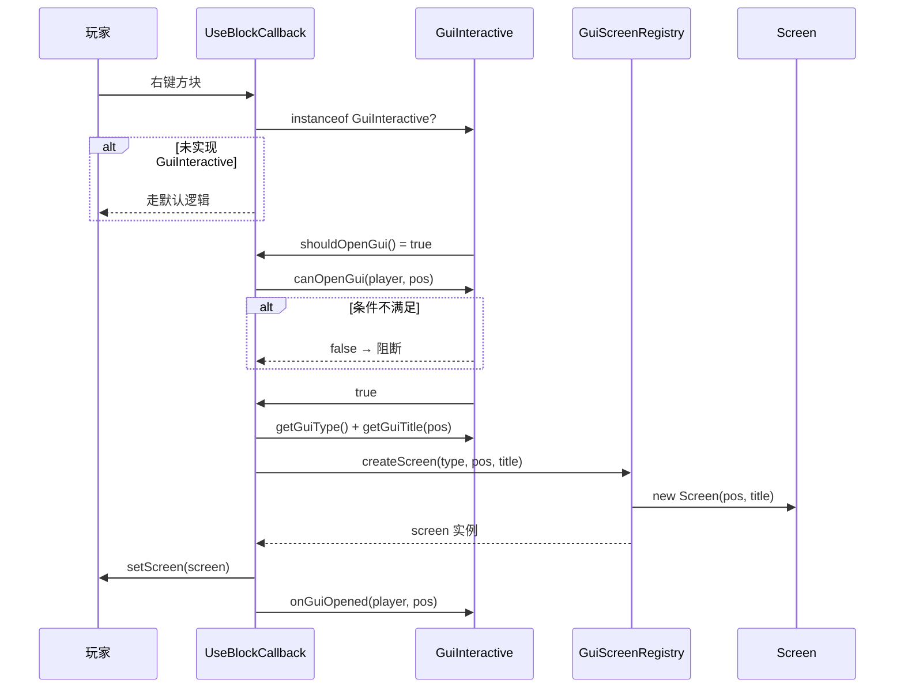

---

### 3.7 BlockInteraction（服务端交互处理器）

| 项目 | 说明 |
|------|------|
| **用途** | 封装完整的右键处理逻辑，由 `Interactive.getInteraction()` 返回 |
| **类型** | `@FunctionalInterface` |

**核心方法**：`ActionResult interact(BlockState, World, BlockPos, PlayerEntity, Hand, BlockHitResult)`

---

### 3.8 OffsetFunction（偏移计算函数式接口）

| 项目 | 说明 |
|------|------|
| **用途** | 向方块构造函数传递偏移配置（函数式替代子类） |
| **类型** | `@FunctionalInterface` |
| **与 Offset 的区别** | `Offset` 是方块的**实例方法**（运行时根据 BlockState 动态计算）；`OffsetFunction` 是**构造时的静态配置** |

---

### 3.9 PlacementBehavior（放置行为挂钩）

| 项目 | 说明 |
|------|------|
| **用途** | 定义方块放置时的状态后处理契约，无需子类重复覆盖 `getPlacementState` |
| **位置** | `util` 包 —— 纯工具接口，不涉及方块模型渲染能力 |
| **继承关系** | `Rotatable extends PlacementBehavior` → `Directional extends Rotatable` |
| **消费方** | `CustomBlock.getPlacementState()` 通过 `instanceof` 分派调用 |

**分派流程**：

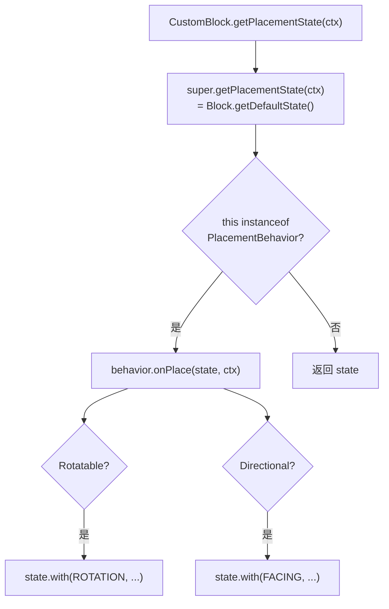

---

## 4. 模型烘焙管线架构

### 4.1 阶段标识接口

| 阶段标识 | 职责 | 属于此阶段的能力接口 |
|----------|------|---------------------|
| `ModelBakeDecorator` | 往模型顶点流里**追加新的几何数据**（如文字层） | `SignTextProvider` |
| `ModelWorldTransformer` | 对**所有已有顶点**做世界坐标变换（旋转、偏移） | `Rotatable` / `Directional` / `Offset` |

### 4.2 插件链结构（从内向外）

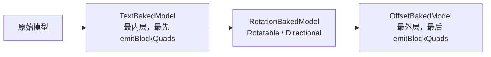

### 4.3 性能保证

- **BakedModel 是全局共享缓存的**，bake 时执行一次
- **emitBlockQuads 运行时的变换**只是在 RenderContext 上做 pushTransform → 矩阵乘法，**零额外 Draw call**
- **装饰层（文字）的顶点**与模型本体走同一个 RenderContext，同样**零额外 Draw call**

---

## 5. 客户端消费架构

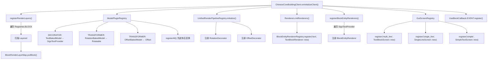

### 渲染管线对比

| 阶段 | 消费方 | 时机 | 处理内容 |
|------|--------|------|----------|
| **模型烘焙（装饰）** | TextBakedModel | 资源加载 | 读取 BlockEntity 数据 → 追加文字层顶点 |
| **模型烘焙（变换）** | RotationBakedModel / OffsetBakedModel | 资源加载 | 读取 BlockState 属性 → 变换所有顶点 |
| **装饰器管线** | UnifiedRenderPipelineRegistry | 每帧渲染 | 装饰器链统一处理旋转/偏移/文字/子模型 |
| **BlockEntity 渲染** | TextBlockRenderer | 每帧渲染 | 使用完整装饰器链：Offset→Rotation→Text |
| **渲染层绑定** | BlockRenderLayerMap | 初始化一次 | Layered.getRenderLayerType() → RenderLayer 映射 |

> **关键一致性保证**：TextBlockRenderer 通过 `UnifiedRenderPipelineRegistry.createBlockEntityChain()` 获取完整装饰器链（Offset→Rotation→Text），与 BakedModel 管线使用相同的变换逻辑，保证方块模型和文字层严格对齐。

---

## 6. 数据流与网络通信

### 6.1 文字数据流

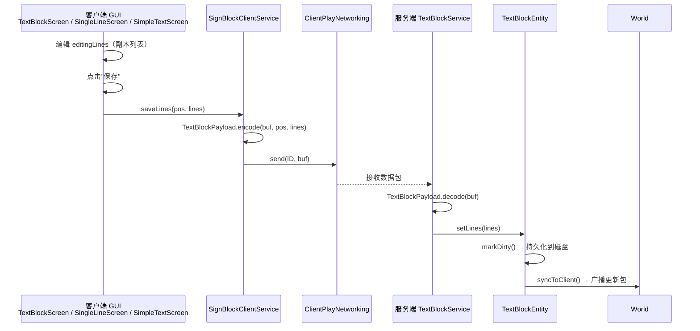

### 6.2 核心数据结构

**TextLine（文字行记录）**：

| 字段 | 类型 | 说明 |
|------|------|------|
| `text` | `Text` | 文字内容（支持 JSON 富文本） |
| `position` | `Vec3d` | 方块空间相对偏移（默认 0.5, 0.6, 1.01 = +Z 面中心） |
| `color` | `int` | 文字颜色 0xAARRGGBB |
| `scale` | `float` | 缩放因子（默认 1.0） |
| `glowing` | `boolean` | 是否发光 |

**TextBlockEntity（文字方块 BlockEntity）**：
- 继承 `CustomBlockEntity`（统一基类）
- 存储 `List<TextLine>`，支持增删改查
- 自动 `markModified()` → 持久化 + 客户端同步

---

## 7. BlockEntity 统一基类

### 7.1 CustomBlockEntity

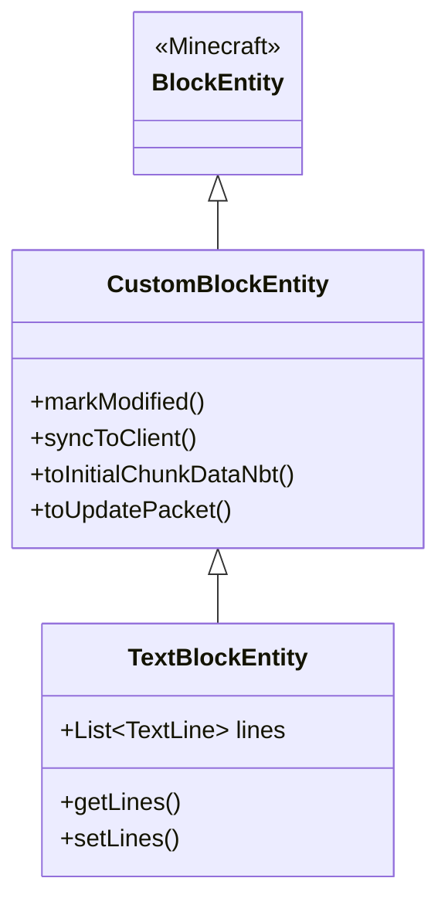

**核心方法**：

| 方法 | 说明 |
|------|------|
| `markModified()` | 标记数据已修改并同步到客户端（markDirty + syncToClient） |
| `syncToClient()` | 向客户端推送当前状态更新（仅服务端有效） |
| `toInitialChunkDataNbt()` | 构造初始区块数据 NBT（追加 writeNbt 自定义字段） |
| `toUpdatePacket()` | 生成客户端同步用的更新数据包 |

---

## 8. GUI 继承层次

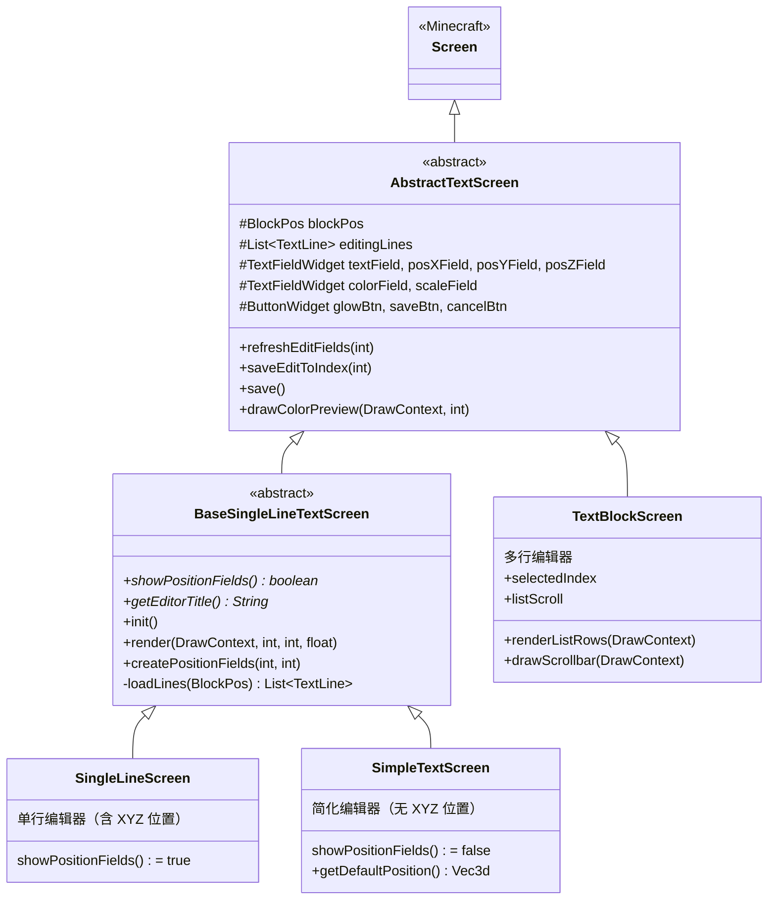

---

## 9. 实现规范 Checklist

实现一个带文字层的方块需满足：

- [ ] Block 类 `implements Directional, Offset, Layered, BlockEntityProvider, SignTextProvider, GuiInteractive`
- [ ] 构造函数：`setDefaultState(initDirection(getDefaultState()))`
- [ ] `appendProperties`：显式调用 `Directional.super.appendProperties(builder)`
- [ ] `getRenderLayerType()` 返回 CUTOUT（文字方块通常有透明区域）
- [ ] `getOffset(BlockState)` 根据 FACING 返回正确的偏移
- [ ] `createBlockEntity(pos, state)` 返回正确类型的 TextBlockEntity 子类
- [ ] `getBlockEntityType()` 返回注册的 BlockEntityType
- [ ] 注册时 BlockEntityType 的 factory 必须与构造函数签名匹配（三元 `(type, pos, state)`）
- [ ] `blocksDefaultInteraction()` 返回 true（阻断原版放置逻辑）
- [ ] （可选）覆盖 `canOpenGui(player, pos)` 添加权限/距离检查
- [ ] （可选）覆盖 `onGuiOpened(player, pos)` 添加音效/粒子回调

---

## 10. 渲染器注册机制

> **历史问题**：原设计通过 `Renderers.Registry` 枚举 + 类字面量 `TextBlockRenderer.class` 触发静态块，
> 但 JVM 类字面量不触发类初始化（JLS §12.4.1），导致 `BlockEntityRendererRegistry` 工厂从未注册，
> 所有文字方块均无 BlockEntityRenderer。

当前实现：`Renderers.initRenderers()` 直接调用 `BlockEntityRendererRegistry.register("text", TextBlockRenderer::new)`，
确保工厂在 `registerBlockEntityRenderers()` 之前注册完毕。

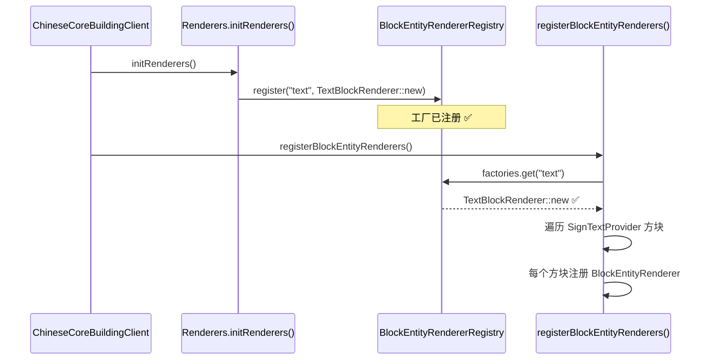

---

## 11. 扩展新能力（开闭原则实践）

想给方块加一种新的渲染能力？

**三步**，不改一行既有代码：

```java
// 1. 新建接口
interface Glowable extends ModelWorldTransformer {
    default boolean shouldGlow(BlockState state) { return false; }
}

// 2. 新建消费方
class GlowBakedModel extends ForwardingBakedModel { ... }

// 3. 在 ChineseCoreBuildingClient.onInitializeClient() 中注册
ModelPluginRegistry.register(
    Phase.TRANSFORMER,
    block -> block instanceof Glowable,
    GlowBakedModel::new
);
```

方块类想获得发光能力？`implements Glowable` 就行。客户端自动扫描。

---

## 12. 常见问题

### Q: 为什么文字渲染在两个地方都有？

- **TextBakedModel**（模型烘焙阶段）：当前版本仅代理原始模型，为未来升级预留
- **TextBlockRenderer**（BlockEntityRenderer）：当前实际渲染文字的地方，每帧调用

两者使用完全一致的装饰器链（Offset→Rotation→Text），保证文字与模型同步。

### Q: 如何添加新的交互逻辑？

实现 `Interactive` 接口的 `getInteraction()` 方法，返回一个 `BlockInteraction` 函数式接口实例即可。

### Q: Renderers 为什么不再使用 Registry 枚举？

枚举 + 类字面量模式在 JVM 中不触发类初始化，导致静态块不执行。改用直接注册方式更简单可靠。